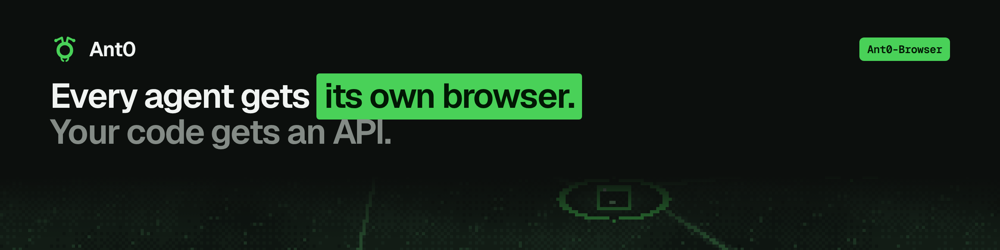

<p align="center">
  <a href="https://ant0.link"></a>
</p>

**A browser for automation and agents, with an API and MCP.**

Ant0 is a desktop browser for Windows and Linux. Each profile is a separate browser with its own
identity, cookies and proxy. You can use profiles by hand in the app, or drive them from your code and
your AI agents.

- **Local API:** start a profile with one POST and get a CDP endpoint for Playwright.
- **CLI:** start, stop and list profiles from a shell.
- **SDKs** for Node and Python.
- **MCP:** an AI agent can list, run and stop profiles.

Everything runs on your computer. Free for 5 profiles.

## Quickstart

1. [Download Ant0](https://ant0.link/download) for Windows or Linux, install it, and sign in with a
   free account.
2. Find your token on the Automation screen in the app, and set it as `ANT0_TOKEN`.
3. Start a profile and connect Playwright:

```js
import { chromium } from "playwright";

const api = "http://127.0.0.1:27100/v1";
const auth = { authorization: `Bearer ${process.env.ANT0_TOKEN}` };

const session = await fetch(`${api}/profiles/Shop%20DE/start`, {
  method: "POST", headers: auth,
}).then((r) => r.json());

const browser = await chromium.connectOverCDP(session.ws_endpoint);
const page = await browser.contexts()[0].newPage();
await page.goto("https://example.com");
```

More in the [docs](https://docs.ant0.link): [API](https://docs.ant0.link/api) ·
[CLI and MCP](https://docs.ant0.link/cli) · [SDKs](https://docs.ant0.link/sdk)

## Repositories

| Repository | What it is | Licence |
|---|---|---|
| [ant0-sdk](https://github.com/Ant0-Browser/ant0-sdk) | Node and Python SDKs | BSD-3-Clause |
| [ant0-mcp](https://github.com/Ant0-Browser/ant0-mcp) | The MCP server for AI agents | BSD-3-Clause |
| ant0-cli (coming soon) | The `ant0` command line | BSD-3-Clause |
| [ant0-examples](https://github.com/Ant0-Browser/ant0-examples) | Recipes for common jobs | MIT-0 |

## What's open source

The repositories above are open source under the licences shown. The SDKs are already on [npm](https://www.npmjs.com/package/ant0-browser) and [PyPI](https://pypi.org/project/ant0-browser/).

The Ant0 desktop app, the Ant0 Browser engine and the Ant0 cloud service are not open source. They're
proprietary and need an Ant0 account, which is free for 5 profiles. The open-source code talks to the
app on your computer.

## Links

[ant0.link](https://ant0.link) · [Download](https://ant0.link/download) ·
[Docs](https://docs.ant0.link) · [Pricing](https://ant0.link/pricing) ·
[Changelog](https://ant0.link/changelog) · [Security](https://ant0.link/.well-known/security.txt)

